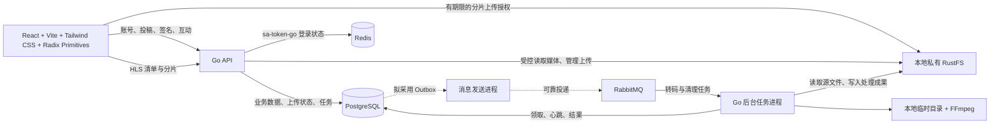

# 视频社区实施方案

状态：整体方案方向已获用户认可，当前按用户要求编写 M0～M5 的详细技术规格，暂不开始 M0。本文保留阶段概览，架构、字段和接口的具体契约移至 [详细规格入口](specs/README.md)。

已确认的产品范围见 [设计记录](design.md)，领域用语见 [术语表](../GLOSSARY.md)。下列内容为总体方案，具体表结构以规格中的 SQL 草案和数据模型为准，HTTP 以接口契约为准；技术文档中的能力说明不代表本机验证结果，暂定直传路径仍需在 M0 实测。

## 设计树与决策状态

- 学习与作品：独立点播视频社区，重点学习 Go 和视频链路。【已确认】
  - 产品：单视频投稿，六类页面，基础账号、弹幕、评论、点赞。【已确认】
  - 发布：全部目标清晰度成功后自动发布；删除阻止后续发布。【已确认】
  - 后端：模块化单体，API 与视频后台进程分开启动。【已确认】
    - HTTP 框架 Gin、数据访问 pgx + sqlc。【已确认】
    - 登录鉴权 sa-token-go，Redis 存储 Token / Session，HttpOnly Cookie 传递 Token，应用负责 CSRF；固定七天有效，允许独立多端登录，退出仅影响当前浏览器。【已确认】
    - 请求中间件：slog、请求 ID、panic 恢复、统一错误、输入限制、分别设置 API/媒体超时及单进程限流。【已确认】
    - 状态与任务：PostgreSQL 保存业务及任务状态，RabbitMQ 派发视频转码和媒体清理工作。【已确认】可靠投递和幂等执行细节见方案建议。
    - 媒体存储：本地私有 S3 兼容存储，用户接受 RustFS 或 MinIO。【已确认】
      - 默认 RustFS 1.0.6，使用其 ARM64 容器镜像。【根据用户接受的备选范围选定，需本机验证】
      - 浏览器分片直传、后端管理上传会话。【暂定，需技术验证】
    - 处理播放：FFmpeg、HLS、hls.js，通过 Go 接口读取媒体。【已确认】
  - 开发：Compose 管理基础服务，Go 与 React 本机调试，逐个里程碑交付并讲解。【已确认】
    - 前端使用 React、TypeScript、Vite、Tailwind CSS 和 Radix Primitives。【已确认】
  - 整体方案：用户认可方向，明确要求先写每阶段的架构、表和接口规格；当前只进行详细设计，不发布工单、不进入实现。

## 组件关系

对象存储中的文件并不天然拥有“已发布”的含义；是否向观众提供内容，以数据库中的投稿状态为准。源视频仅供内部处理，不向观众提供直接下载入口。

## 实现默认值

| 范围 | 建议默认值 |
| --- | --- |
| Go 服务 | 已确认 Gin 及下文列明的请求中间件 |
| 前端 | 已确认 React + TypeScript + Vite + Tailwind CSS + Radix Primitives，hls.js 播放 |
| 数据访问 | 已确认 pgx + sqlc，事务边界放在业务操作中 |
| 登录 | 已确认 sa-token-go + Redis + HttpOnly Cookie，固定七天有效，多端独立 Token，退出当前登录，应用负责 CSRF |
| 消息队列 | 已确认 RabbitMQ，用于转码和媒体清理；持久消息、确认、Outbox 和幂等消费为具体实施建议 |
| 对象存储 | 固定 `rustfs/rustfs:1.0.6`，ARM64 镜像和持久卷；仅本机暴露服务，拉取后记录实际镜像摘要 |
| 对象存储访问 | AWS SDK for Go v2，配置独立 endpoint 与 path-style；业务记录对象 key，不存临时签名 URL；浏览器仅获得指定分片的临时授权，不获得存储访问密钥 |
| 大小上限 | 1 GB 明确为 1,000,000,000 字节；界面与后端使用同一上限 |
| 分片 | 初始 8 MiB，每个上传最多并行三片；续传使用同一上传会话及固定分片边界 |
| 内容校验 | 浏览器增量计算 SHA-256，避免把整个大文件一次性加载进内存；后端在转码前复核完整对象及分块，ETag 不当作文件内容哈希 |
| 转码并发 | 一次处理一个转码任务，各目标档位依次生成；记录耗时和资源使用后再调整 |
| 临时目录 | 每次处理有独立工作目录，用于源文件下载和 FFmpeg 输出；最终成果写入对象存储，临时目录在完成或安全回收后清理 |
| 时间与期限 | 数据库存 UTC，页面按本地时区显示；上传七天无活动过期。用户尚未指定完成日期，按可验收里程碑推进 |

这些默认值用于使方案可实施；工具小版本、错误码、文本长度等低层细节在对应模块实现时固定并写入接口文档，不额外扩展产品范围。

## 已确认的应用框架与中间件

Gin、pgx + sqlc、sa-token-go + Redis + HttpOnly Cookie、RabbitMQ、Radix Primitives，以及请求中间件和登录生命周期均已由用户确认。

| 决策 | 已确认方案 | 实现边界 |
| --- | --- | --- |
| Radix 形态 | 已确认 Radix Primitives，外观使用 Tailwind CSS | 结束与 Radix Themes 的选型比较 |
| HTTP 框架 | 已确认 Gin，负责路由、绑定校验、HTTP 中间件，业务层使用普通 Go 类型 | 结束 Echo 与标准库路由的选型比较 |
| 数据访问 | 已确认 pgxpool + sqlc，手写 SQL 并生成类型安全的调用代码 | 结束与 GORM 的选型比较 |
| 登录机制 | 已确认 sa-token-go，采用其 Gin 集成 | 业务负责账号密码验证和资源归属检查 |
| 鉴权存储 | 已确认 Redis 保存 Token / Session 状态，Compose 管理并配置持久化及数据卷 | 第一版专注鉴权状态，业务数据仍在 PostgreSQL |
| Token 传递 | 已确认 HttpOnly Cookie，由 sa-token-go 读取和校验 | 应用负责 CSRF、Cookie 属性和退出清除，不把这些视为库自动完成 |
| MQ | 已确认 RabbitMQ，用于转码及媒体清理 | 单机资源对比属于基于配置的工程判断，没有本机负载实测 |
| 请求日志 | 已确认标准库 slog，结构化记录请求与后台任务 | 不记录认证凭据或媒体正文 |

已确认的请求处理能力：请求 ID、结构化访问日志、panic 恢复、统一错误响应、API 请求体限制和参数校验、登录态与资源权限、普通 API 与媒体分开设置的超时及取消、Cookie 认证下的 CSRF 防护，以及登录/注册/创建上传等操作的单进程限流。跨域访问按实际开发端点配置 CORS；参数校验可由绑定/处理器负责，不要求所有能力都实现为全局中间件。

媒体路由不能直接套普通 JSON API 的短超时或整响应缓冲。HLS 清单和分片是独立 HTTP 请求，媒体代理需要流式读取并在客户端断开时取消下游；权限检查覆盖媒体请求，日志不记录视频正文或认证凭据。

基础服务与这些请求中间件不同：PostgreSQL、私有对象存储、Redis、RabbitMQ 均已确定。原先“暂不引入 Redis 或独立 MQ”的组合决定已失效。FFmpeg 是后台处理工具，Gin 不承担转码调度。

### MQ 选择与实施建议

用户已选择 RabbitMQ。针对本机 16 GiB 内存、低消息量、单节点开发，它的一个节点即可承载工作队列；RocketMQ 官方单机部署通常需要 NameServer 与 Broker 两个进程，Proxy 可并入 Broker，无需强制额外部署第三个进程。资源取舍基于部署结构与配置，没有本机同负载 RSS、CPU 或磁盘实测。

RocketMQ 可调小 JVM 堆；不能将发行包的堆默认值套到所有 Docker 镜像，亦不能把 JVM 堆上限当成实际内存占用。RabbitMQ 的内存水位用于告警和阻止发布者继续发送，不是启动预留内存或硬内存上限。固定实际镜像后需结合本项目其他服务测量和配置。

比较依据：[RabbitMQ 安装](https://www.rabbitmq.com/docs/download)、[RocketMQ 单机 Docker 部署](https://rocketmq.apache.org/docs/quickStart/02quickstartWithDocker/)、[RocketMQ Docker Broker 启动脚本](https://github.com/apache/rocketmq-docker/blob/master/image-build/scripts/runbroker-customize.sh)、[RabbitMQ 内存水位](https://www.rabbitmq.com/docs/memory)。

MQ 的首期用途已确认为视频转码和媒体清理。具体建议为：消息只携带任务标识和版本，不携带视频文件；账号、评论和点赞同步提交数据库。PostgreSQL 保留可供页面查询的任务状态、尝试次数和幂等执行记录。

建议使用 outbox 处理数据库与 MQ 的双写窗口：同一事务写入业务状态及待发送消息，发送进程可靠投递至 MQ 后记录发送结果。确认丢失可能导致重复发送，消息重投也可能重复触发消费，因此发布和删除规则仍需数据库条件更新及幂等处理。

RabbitMQ 实施建议：使用持久队列和持久消息、发布确认及不可路由消息处理；消费者手动确认，转码任务先按 prefetch=1 执行。可重试失败先持久化下一次重试计划再确认当前消息，避免无限立即重入队；消息投递次数不直接等于实际转码尝试次数。固定版本后明确消费确认超时与最长单次任务时间，不能把连接 heartbeat 当作延长任务确认期限。

官方依据：[RabbitMQ 可靠性](https://www.rabbitmq.com/docs/reliability)、[发布与消费确认](https://www.rabbitmq.com/docs/confirms)、[Go 客户端](https://github.com/rabbitmq/amqp091-go)、[消费确认超时](https://www.rabbitmq.com/docs/consumers#acknowledgement-timeout)。队列产品和用途已确认，具体实施建议待整体核对，以上不是已运行或已验收结果。

### sa-token-go 集成边界

使用用户指定的 [sa-token-go](https://github.com/sa-tokens/sa-token-go/blob/main/README_zh.md)，不要求采用 JWT。官方提供 Gin 集成和内存/Redis 存储模块；账号注册、密码哈希校验及投稿归属仍由业务层处理，再调用库建立或验证登录态。

已确认的登录生命周期：登录固定七天有效，不随访问自动续期；允许多个浏览器分别登录并使用独立 Token，第一版不做设备管理页面；退出只撤销当前 Token 并清除当前 Cookie。依据 v0.2.3 源码，配置为 Timeout=604800、AutoRenew=false、ActiveTimeout=-1、IsConcurrent=true、IsShare=false；登录数量配置显式设为不自动淘汰其他端，登录接口另作限流，防止库默认上限意外改变已确认的多端行为。

多端验证需特别覆盖“浏览器 A 退出后浏览器 B 仍能使用”；退出使用当前 Token 的注销入口，不使用按账号批量注销入口。配置与实现依据：[配置定义](https://github.com/sa-tokens/sa-token-go/blob/v0.2.3/core/config/config.go)、[登录和注销实现](https://github.com/sa-tokens/sa-token-go/blob/v0.2.3/core/manager/manager.go)。目前仅做静态源码核查，尚未运行测试。

库的 main 文档与已发布模块需要按版本对照；实施时固定相互兼容的 core、Gin 集成和存储版本，并验证登录、注销、重启后的状态和 Cookie 属性。媒体的公开可见性继续依据投稿状态，不能把游客观看路径全部放进必须登录的路由组。

只读核查中需在 M0 验证的具体点：已发布 v0.2.3 的 Gin 模块要求 Go 1.25、Gin 1.12，而 main 内部版本已写为 v0.2.4；Cookie 读取需显式开启，存储需显式传入。该版本的 Gin adapter 在写 Cookie 后才设置 SameSite，拟由应用直接设置完整 `http.Cookie` 并检查实际响应头；统一 Token 读取还包含 Query 回退，若选择只接收 Cookie，需要在应用入口明确约束。以上来自源码对照，尚未运行测试。

参考：[已发布 Gin 模块](https://github.com/sa-tokens/sa-token-go/blob/v0.2.3/integrations/gin/go.mod)、[Cookie adapter](https://github.com/sa-tokens/sa-token-go/blob/v0.2.3/integrations/gin/context.go)、[Token 读取](https://github.com/sa-tokens/sa-token-go/blob/v0.2.3/core/context/context.go)。

官方参考：[Radix Primitives](https://www.radix-ui.com/primitives/docs/overview/introduction)、[Radix Themes](https://www.radix-ui.com/themes/docs/overview/getting-started)、[Gin](https://gin-gonic.com/en/docs/)、[Echo 错误处理](https://echo.labstack.com/guide/error-handling/)、[标准库路由](https://go.dev/blog/routing-enhancements)、[pgx](https://github.com/jackc/pgx)、[sqlc 事务](https://docs.sqlc.dev/en/stable/howto/transactions.html)、[GORM 行锁](https://gorm.io/docs/advanced_query.html#Locking)、[slog](https://pkg.go.dev/log/slog)、[HTTP 超时包装的限制](https://pkg.go.dev/net/http#TimeoutHandler)。

RustFS 默认选择依据：[固定发行版本](https://github.com/rustfs/rustfs/releases/tag/1.0.6)、[官方镜像](https://hub.docker.com/r/rustfs/rustfs/tags)、[Docker 部署](https://docs.rustfs.com/en/installation/container/docker)、[Go SDK](https://docs.rustfs.com/en/developer/sdk/go)。[官方 S3 说明](https://docs.rustfs.com/en/administration/protocols/s3)并不承诺所有行为与 AWS S3 相同，尤其需用固定版本验证浏览器 multipart 签名、CORS 和 ETag 可读性；目前只有文档核查，没有本机实测结果。

## 投稿与任务状态分开管理

投稿的主流程为：`上传中 → 处理中 → 已发布`。处理中包括完整性校验、格式探测、封面生成、多档转码和成果确认，不能仅凭文件已上传就发布。

- 上传超期进入“已过期”，重新上传需要创建新会话；不允许续传到已关闭的会话。
- 不支持的编码或内容校验失败向作者反馈明确原因，不进行无意义的自动重试；需要更换文件时创建新投稿。
- 可重试的处理错误在首次执行失败后最多自动重试三次，耗尽后显示“处理失败”，作者可手动发起新一轮重试。
- 已成功且校验通过的档位继续保留，失败或中断的一档允许从头处理。
- 作者删除使投稿进入不可恢复的“已删除”；所有发布操作必须再次检查这一状态。

任务状态独立记录等待、执行、重试、失败和完成。具体实施建议为：RabbitMQ 派发工作，数据库条件更新确认当前执行资格；心跳/租约记录活跃执行，超时回收时使旧执行代次失效，并经 Outbox 派发恢复任务。迟到的旧进程不能提交有效成果，消费者先持久化成功、终态或重试计划后再确认当前消息。MQ 不会让消息投递、外部文件操作与数据库事务自动成为原子操作。

## 上传与直传验证

1. 用户填好标题与简介，点击“上传并自动发布”；后端创建投稿及所属用户的上传会话。
2. 后端创建 multipart upload，保存对象 key 与上传编号，仅为该会话签发短时有效的分片上传地址。
3. 浏览器上传分片并报告进度；后端与存储端的分片列表对账。刷新页面后，用户重新选择同一文件，校验内容身份后继续。
4. 签名过期允许重新申请；续传所需的权限、分片编号和内容校验不能仅信任前端。
5. 完成请求由后端处理，核对分片及对象大小并幂等地完成上传。创建处理任务后，由后台复核文件哈希并通过 ffprobe 检查真实媒体参数。
6. 七天无活动的会话由清理任务中止分片上传，并处理临时记录及孤立文件；已完成上传进入处理阶段后不再套用上传闲置期限。

直传尚属暂定方案。第一阶段必须实测分片签名、CORS 预检及浏览器读取 ETag、分片列表读取、页面重开恢复、签名续期、完成/中止和校验；若关键兼容项失败，记录复现结果，再决定修正适配或改为经 Go 转发分片，不静默改变用户选择。

## 发布、访问控制与删除

- 每档转码成果写入独立的处理尝试路径，校验文件齐全后再登记有效成果，避免把半成品当作成功结果。
- 全部目标档位及封面就绪后，使用短事务确认投稿未删除、任务仍持有有效执行资格，再设置已发布状态与成果引用。
- 使用执行代次防止租约过期后旧进程覆盖新进程结果。迟到的旧成果作为待清理对象处理，不参与发布。
- 媒体接口根据投稿 ID 和已登记的媒体资源定位对象，每次请求检查状态；不允许客户端指定任意对象 key。HLS 清单中的引用也通过受控接口访问。
- 观众只能访问已发布投稿；作者可以查看自己的未发布资料和处理状态。第一版不额外提供未发布视频的预览功能。
- 删除先在数据库撤销可见性，再异步中止上传、停止/隔离处理结果并清理对象。清理失败记录错误并重试，不重新开放访问。
- 删除后新媒体请求被拒绝；不能撤回浏览器已经收到或缓冲的字节。媒体响应缓存策略须与这个边界一致。
- 数据库事务失败、进程崩溃或迟到写入可能留下孤立对象，需要可重复执行的清理任务；清理不能删除仍由有效任务使用的文件。

## 实施里程碑

M0～M5 各有独立 spec，列明架构、表/API 增量、流程、异常和验收编号。每次后续实现须先声明覆盖的验收编号，再报告实际改动和证据，记录在 [进度文件](specs/progress.md)；不能只用“完成 M2”等粗粒度结论汇报。

| 阶段 | 可运行成果 | 主要学习点与验证 |
| --- | --- | --- |
| M0 环境与兼容性验证 | 固定版本的 PostgreSQL、RustFS、RabbitMQ、Redis；最小 Gin 与 React 启动；一条浏览器分片上传验证流程 | 核实 Go、Docker 与 ARM64 环境；sa-token-go 登录/注销与模块兼容性；RabbitMQ 发布/消费确认和重投；私有桶、预签名、CORS、恢复、完整性和中止上传；记录基础服务资源并验证暂定直传路径 |
| M1 账号与投稿骨架 | sa-token-go 注册登录集成、退出、投稿元数据、我的投稿页面和数据库迁移 | Go 项目组织、错误处理、接口与实现、context、事务；验证账号密码及资源归属，区分框架认证与业务授权 |
| M2 上传与续传 | 完整上传界面、同文件续传、错误提示及过期清理 | S3 multipart 与业务上传会话的区别；断网、刷新、同名不同内容、重复完成、越权访问 |
| M3 转码与播放 | 多档转码、封面、自动发布、首页与视频详情页、受控 HLS 播放 | Go 调用外部进程、持久后台任务、发布门槛；格式拒绝、无音轨、档位选择、拖动与切换清晰度 |
| M4 互动与内容管理 | 弹幕、平铺评论、点赞、编辑资料和删除 | 视频时间与现实时间的区别、唯一约束和幂等、评论权限、删除与处理竞争 |
| M5 故障恢复与作品交付 | 可重复执行的验收流程、资源记录、启动说明和故障排查文档 | 中途杀进程、重启恢复、任务重复领取、局部失败、删除竞态、存储暂时不可用与清理重试 |

每个阶段交付可运行代码、必要验证和结合 Java 经验的 Go 讲解。恢复机制随功能一起设计和实现，M5 集中验证整条链路，不把所有可靠性工作推迟到最后。

## 最终验收

- 用符合范围的 360p、480p、720p、1080p 样本验证输出档位和比例，覆盖无音轨及非法格式；测试素材使用本地生成或有权使用的文件。
- 从注册到上传、处理、发布、播放、互动形成完整用户流程，游客可观看，写操作需要登录。
- 验证登录七天固定过期、访问不续期、多浏览器独立登录、当前端退出及 Cookie/CSRF 行为；时间相关测试通过可控时钟或等价测试配置完成，不真实等待七天。
- 在上传中断、后台崩溃、某一档失败、重复完成和重复执行的情况下，状态及媒体成果保持一致；全部目标档位就绪前不能发布。
- 删除上传中、处理中和已发布的投稿，确认新的媒体请求拒绝、迟到任务不能复活投稿，后台文件最终能清理。
- 验证评论删除权限、点赞重复请求及取消、弹幕在视频指定位置出现。
- 一个文件上传、一个后台转码任务与两个浏览器会话观看可同时进行，记录处理耗时、CPU、内存和磁盘，不在测量前承诺吞吐量。
- 依据实际启动验证固定依赖版本、命令和样例配置；数据库与媒体持久数据不得被普通重启或恢复步骤意外清空。
