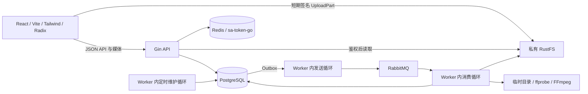

# 总架构与公共约定

状态：v0.1 设计评审稿。

## 1. 进程与职责

| 运行单元 | 职责 | 不拥有的职责 |
| --- | --- | --- |
| Web 开发进程 | 六类页面、上传进度、播放器、互动；通过 Vite 同源代理访问 API | 不保存服务端存储密钥，不决定投稿发布状态 |
| API 进程 | Gin 路由、sa-token-go、业务事务、上传授权、媒体代理 | 不在请求中执行长时间转码 |
| Worker 进程 | Outbox 发送、任务消费、租约恢复、过期及孤立文件清理 | 不直接修改账号登录态 |
| PostgreSQL | 业务事实、上传协议状态、处理状态、资源引用、待发送消息 | 不作为媒体文件存储 |
| Redis | sa-token-go Token / Session；持久化及数据卷 | 不保存点赞计数或任务真相 |
| RabbitMQ | 工作派发与确认 | 不替代数据库中的可查询业务状态 |
| RustFS | 私有源视频、封面、HLS 成果 | 不根据文件是否存在决定是否已发布 |

API 和 Worker 来自同一个 Go 项目，业务模块使用普通 Go 类型与 `context.Context`。Gin 类型止于 HTTP 接入层。Worker 的发送、维护、处理消费、清理消费是独立循环，不能被一个长转码阻塞。

## 2. 模块边界

| 模块 | 输入与输出 | 数据所有权 |
| --- | --- | --- |
| Account | 注册、校验密码、当前用户 | users |
| Auth adapter | 创建/校验/撤销当前 Token | Redis 中 sa-token-go 数据；不自建登录表 |
| Submission | 创建、查询、修改、删除投稿，发布条件检查 | submissions |
| Upload | 创建上传会话、签发分片地址、对账、完成及中止 | upload_sessions、upload_parts |
| Media | 资源登记、私有读取、清理 | media_objects、media_variants |
| Processing | 校验、探测、封面、转码和最终发布 | jobs、job_attempts；通过明确事务更新投稿和媒体状态 |
| Delivery | Outbox 与 RabbitMQ 发布/消费适配 | outbox_events |
| Community | 评论、点赞、弹幕 | comments、likes、danmaku |
| Maintenance | 过期上传、失效租约、孤立文件 | 只通过上述模块的维护入口执行 |

一个业务事务可以更新多个归属相关的表，不能为遵守分层而把必须原子的变化拆开。数据库事务不跨 FFmpeg、S3 或 RabbitMQ 网络调用持有。

## 3. 运行与配置契约

基础服务由 Compose 管理，API、Worker、前端本机调试。仅监听回环地址；下面是本地默认端口，冲突时通过配置整体调整。

| 服务 | 地址/端口 | 持久数据 |
| --- | --- | --- |
| Web | localhost:5173 | 无 |
| API | 127.0.0.1:8080 | 无本机业务状态 |
| Worker 健康检查 | 127.0.0.1:8081 | 有界临时工作目录 |
| PostgreSQL | 127.0.0.1:5432 | 命名数据卷 |
| Redis | 127.0.0.1:6379 | AOF + 命名数据卷 |
| RabbitMQ | 127.0.0.1:5672，管理端 15672 | 命名数据卷 |
| RustFS | 127.0.0.1:9000，管理端 9001 | 命名数据卷 |

配置项按用途分组：数据库 DSN、Redis 地址/凭据、AMQP 地址/凭据、S3 endpoint/region/bucket/访问密钥、前端允许 Origin、CSRF 与游标签名密钥、临时目录、租约/超时/并发。样例配置只有占位符；启动时校验必填项，日志隐藏凭据。业务配置通过环境读取，数据库结构通过版本化 SQL 迁移；sqlc 根据受版本管理的 SQL 生成调用代码。

RustFS 固定候选为 1.0.6。sa-token-go 先以已核查的 v0.2.3 模块组合验证，其 Gin 模块要求 Go 1.25 / Gin 1.12；实际使用相互兼容的固定版本。其他基础服务的具体补丁版本、ARM64 镜像摘要与客户端版本由 M0 锁定并记录，禁止以 `latest` 作为可复现交付依据。这里不把未拉取的镜像写成已验证可用。

## 4. 身份与请求链

请求 ID → 日志及恢复 → 请求体限制 → 来源/CSRF 检查与登录态解析 → 路由权限 → 业务处理。具体排列须保证未登录返回 401、无效 CSRF 返回 403，且错误被统一记录。公开播放路径不强制登录，仍检查投稿是否发布。

- 用户名：3～32 个 ASCII 字母、数字、下划线；保留原始大小写，注册唯一性和登录查询均区分大小写，不执行大小写转换。数据库使用大小写敏感的唯一约束兜底；`Alice` 与 `alice` 可分别注册。密码不 trim，8～128 个 UTF-8 字节；使用 Argon2id，初始参数内存 19 MiB、迭代 2、并行度 1，随机盐与参数写入哈希串，实际耗时在 M1 记录。
- Session Cookie 名 `bili_session`，Host-only、Path=/、HttpOnly、SameSite=Lax、固定七天；仅本地 HTTP 配置允许 Secure=false。Token 不出现在 JSON、URL、localStorage 或日志中。
- sa-token-go：Timeout=604800、AutoRenew=false、ActiveTimeout=-1、IsConcurrent=true、IsShare=false；不因库默认登录数量限制自动淘汰其他浏览器。退出调用当前 Token 的注销方法。
- CSRF：采用绑定当前会话的 HMAC 签名双提交方案。`GET /auth/csrf` 返回 Token 并写同名校验 Cookie；写请求提交 `X-CSRF-Token`。服务端检查头/Cookie 匹配、签名和 Origin。登录前绑定匿名上下文，登录成功后换发绑定新会话的 CSRF Token；它不能用作身份 Token。
- 项目入口明确只以 Cookie 识别身份，不使用库的 Query Token 回退。S3 预签名 URL 是另一服务的上传授权，不受这个身份读取规则影响。
- 初始单进程限流：注册按 IP 每小时 10 次；登录按 IP 每分钟 20 次且账号每分钟 10 次；创建投稿/上传按用户每分钟 10 次。返回 429 和 Retry-After，阈值进入配置。反向代理信任列表默认空，不能无条件相信 X-Forwarded-For。

## 5. 公共技术约定

- 主键由应用生成 UUID v4，API 使用字符串；时间使用 PostgreSQL timestamptz / UTC，JSON 为 RFC3339；视频位置/时长使用整数毫秒。
- 普通 JSON 请求最大 256 KiB。列表默认 20、最多 100；弹幕每页默认 200、最多 500。输入长度按 Unicode 字符计数，密码例外按字节。
- JSON API 默认 10 秒操作超时，需向数据库和下游传递取消；multipart 完成操作最多 30 秒，结果未知时走恢复流程。媒体路由逐请求流式读取，不使用整响应缓冲；上游连接/响应头设短超时，连续无数据 30 秒或客户端断开时取消。
- 错误统一为业务错误码、可展示中文消息、请求 ID；不返回 SQL、堆栈、对象密钥或完整签名 URL。
- 不使用 Redis 缓存业务计数。第一版点赞和评论数从有索引的关系表计算，避免引入异步计数一致性问题。
- 普通读取不使用长事务。列表采用稳定排序的游标分页，不承诺跨页数据库快照；删除中的条目可以消失，但不会通过 offset 漂移重复翻页。

## 6. 媒体与消息公共约定

私有桶 `bili-media`。对象 key 只由服务端构造：源文件按投稿和上传会话隔离，处理成果按投稿、媒体代次、任务和租约 Token 隔离。数据库保存 key 和资源 ID，浏览器得到受控媒体 URL；不接受客户端任意指定读取 key。

RabbitMQ 使用 durable direct exchange `bili.jobs`，两个持久工作队列 `bili.processing`、`bili.cleanup`，路由键分别为 `processing`、`cleanup`。选择单成员 quorum queue 作为本地基线；它不提供多副本高可用。处理消费与清理消费各 prefetch=1，处理侧同一时刻只运行一个重任务。

另设持久死信交换机 `bili.dead` 和对应的两个隔离队列，工作队列 delivery-limit 显式设为 20，配合 at-least-once dead lettering 与 reject-publish overflow；M0 必须验证固定版本支持的配置。不能让 broker 达到重投上限后静默丢弃工作。有效任务的死信由维护逻辑与数据库对账：过时/已终态消息可确认；派发耗尽的处理任务显示可重试失败；清理任务按退避重新生成派发事件。格式不合法或未知版本的消息保留在隔离队列供排查，不无限回到工作队列。[RabbitMQ quorum 与死信](https://www.rabbitmq.com/docs/quorum-queues)

消息版本 `job.available.v1`，字段固定为 event_id、job_id、dispatch_seq、schema_version=1、correlation_id；不带媒体正文或密码。持久发布，启用 publisher confirm 与 mandatory，不可路由返回必须作为投递失败处理；仅收到 confirm 不能认定业务执行成功。Outbox 和执行栅栏见 M2/M3。

## 7. 参考依据与验证边界

设计选择依据：[密码哈希](https://cheatsheetseries.owasp.org/cheatsheets/Password_Storage_Cheat_Sheet.html)、[CSRF](https://cheatsheetseries.owasp.org/cheatsheets/Cross-Site_Request_Forgery_Prevention_Cheat_Sheet.html)、[S3 multipart](https://docs.aws.amazon.com/AmazonS3/latest/userguide/mpuoverview.html)、[RabbitMQ 确认](https://www.rabbitmq.com/docs/confirms)、[FFmpeg HLS](https://ffmpeg.org/ffmpeg-formats.html#hls-2)。S3 文档描述的是协议参考，RustFS 固定版本的行为必须经过 V-01/V-02 验证。
