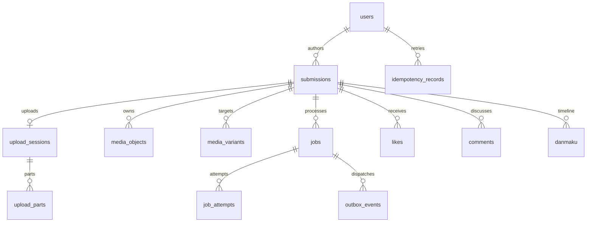

# 数据模型、状态与事务

状态：v0.1 设计评审稿。完整列定义见 [schema.sql](schema.sql)；该 SQL 是最终结构快照，不应在 M1 一次性执行。以下分阶段说明迁移顺序和字段语义。

## 1. 表的引入阶段

| 阶段 | 新表 | 对既有表的增量 |
| --- | --- | --- |
| M0 | 无业务表 | 只在测试连接中使用临时表，回滚后不留业务结构 |
| M1 | users、submissions、idempotency_records | submissions 先具备身份、资料、状态、version、media_generation、process_cycle、错误及时间字段 |
| M2 | media_objects、upload_sessions、upload_parts、jobs、job_attempts、outbox_events | submissions 增加 source_media_id、source_verified_at，并建立 source FK；media_objects.job_id 在 jobs 建好后加 FK |
| M3 | media_variants | submissions 增加 cover_media_id、duration_ms、width、height、frame_rate、video_codec、audio_codec；添加 cover FK 及完整的发布约束 |
| M4 | likes、comments、danmaku | 无需给 submissions 增加异步计数缓存字段 |
| M5 | 无新增业务表 | 根据验证结果调整索引或约束时，另写迁移并回填变更记录 |

M1/M2 不允许状态进入 published；M3 迁移后启用发布逻辑。升级 M3 时，幂等扫描“源文件已验证且仍未处理”的投稿，为它们创建缺失的 probe 任务；不能把 M2 的合法数据遗留在永久等待状态。

## 2. 关系

## 3. 字段语义与约束责任

### users

id 是稳定身份，username 为保留原始大小写的唯一用户名；唯一性与登录查询均区分大小写，`Alice` 与 `alice` 可以属于不同用户。该列显式使用 `COLLATE "C"`，注册和登录不执行 lower/upper 转换，查询使用等值比较。password_hash 保存带算法参数和盐的哈希串；created_at / updated_at 记录创建和修改。第一版不设计昵称、邮箱、角色管理或密码找回字段。任何登录态都不放在此表。

### submissions

author_id 决定投稿归属。title / description 是可编辑资料；state 是对外可见的生命周期；processing_stage 只是作者进度标签，不决定观看权限。

version 是资料/生命周期修改版本，用于 PATCH 的 If-Match；普通任务心跳、点赞和评论不递增它。media_generation 是媒体有效代次，删除时递增，使旧上传/处理不能重新激活成果；修改标题不改变它。process_cycle 记录作者手动重试轮次，成功档位可跨轮次复用。

source_media_id / cover_media_id 引用资源登记；source_verified_at 表示完整大小和哈希已核对，不表示编码合法。duration_ms、展示方向下的 width/height、frame_rate 和编码字段仅在 probe 通过后写入；不能先把不合规高度写入受约束的列再判断失败。audio_codec 为空代表无音轨。

error_code / error_message / retryable 用于作者反馈，必须经过脱敏映射；published_at 仅在首次发布成功时赋值。删除保留投稿墓碑及 author_id，后续查询隐藏它，后台据此拒绝迟到结果并清理资源。

### idempotency_records

主键为“用户 + 操作范围 + 请求键”。scope 包括操作和父资源，例如 `comment.create:{submission_id}`。request_sha256 是规范化请求的哈希；同键不同内容返回 409。与业务写入同事务保存 resource_type / resource_id / response_status，保留七天。

不存密码、Cookie、临时 URL 或整段响应。重放时查询原资源并返回其当前表示；资源已删除则返回 410，不重新创建。单纯重复 PUT 点赞和 DELETE 直接依赖状态幂等，不使用该表。

### media_objects

每个外部对象一行。kind 区分 source / cover / playlist / segment；quality_height 只对 HLS 成果有意义。media_generation、job_id、attempt_token 把处理产物绑定到一次可校验的执行资格。

bucket / object_key 是内部定位信息；state 从 staging 变为 ready，再经 cleanup_pending 到 deleted。ready_at 和 size_bytes 在验证对象完整后写入。sha256 在计算过时保存；etag 是存储版本标识，不能充当文件 SHA-256。源视频、封面、清单引用必须属于同一投稿、正确 kind 和有效代次，这些跨表条件在短事务中核验。

不能把整个存储桶设为公开；即使对象 ready，仍须经过投稿可见性判断。清单中的每个分片都有登记行，禁止透传任意 key。

### upload_sessions / upload_parts

每个投稿仅一个上传会话。expected_size、file_sha256、part_size、part_count 和各分片的 size_bytes / sha256 在创建时固定，后续不允许改成另一份文件。

multipart_upload_id 为 S3 侧编号。operation_token / operation_expires_at 防止多个请求同时初始化或完成同一会话，租约默认 60 秒；网络调用最长 30 秒，不能持有数据库事务等待网络。回写时必须同时检查操作 Token、会话状态及投稿未删除。

分片的 etag / confirmed_at 表示服务端 ListParts 对账确认了远端存在、大小和 ETag；不表示内容已经通过 SHA-256 验证。完整对象由后台按固定分片边界重新计算分片及全文件哈希。

有效签名申请、成功分片对账和成功续传会更新 last_activity_at，并将 expires_at 延后七天；纯页面轮询不延长。没有上传会话的 uploading 投稿以创建时间计算七天过期。completed 会话不再受上传闲置过期规则影响。

### jobs / job_attempts

jobs 是业务任务，job_attempts 是真正取得执行资格的尝试。消息重投不直接增加 attempt_count。kind 为 verify_source / probe / cover / transcode / cleanup；target_key 为 source、cover、quality:720 或受控清理范围。

dedupe_key 的语义为投稿、媒体代次、任务类型、目标和手动重试轮次，同一工作不能重复建任务。payload 只保存必要参数；执行前重新从数据库读取权威状态。cleanup 可以没有投稿 ID，例如独立孤立文件清理，但清理 key 仍必须限制在本项目命名空间。

媒体处理任务 max_attempts=4，即首次尝试加三次自动重试；cleanup 的 max_attempts 为空，失败持续按有界退避重试。job_attempts 保留每次租约、开始/结束和结果，帮助解释“消息重复了”与“确实重新处理了”的区别。

lease_token 是当前执行栅栏，lease_expires_at 默认领取后 120 秒，heartbeat 每 30 秒续期。最终写入需匹配 job、lease_token、dispatch_seq、media_generation 及未删除状态。任务超时后，维护循环令旧租约失效并派发恢复任务；旧进程即使继续上传，也只能留下待清理的孤立对象。

### outbox_events

每个 job 的每个 dispatch_seq 最多一条事件。业务事务与 Outbox 写入原子提交。发送循环用短事务领取、独立网络调用发布、再确认结果，使用独立 30 秒发送租约；不能把数据库锁持有到等待 broker confirm 结束。

sent_at 表示确认投递完成，不表示处理完成。publish_attempts 与 jobs.attempt_count 不同。不可路由、超时或不确定结果保持未发送，按 1、2、4…最多 60 秒加抖动重试。丢失确认可能重复发送，消费端仍需幂等。

### media_variants

主键为投稿和目标清晰度；只有源画面高度允许的档位才建行。target_width 为保持展示宽高比的偶数宽度。ready 要求有效 playlist_media_id、duration_ms 和 bandwidth_bps；发布主清单据此生成，不凭文件名猜清晰度。codec_string 只有在从输出可靠取得合法 RFC 6381 值时保存，否则为空，主清单省略可选 CODECS 属性，不填写猜测值。

### likes / comments / danmaku

likes 的复合主键保证一用户一有效点赞，取消时删除关系。comments 无 parent_id，明确不支持回复；删除评论置 deleted_at 并清空 body，列表隐藏它。danmaku 用 position_ms 定位，不用现实发送时间定位；业务校验 `0 <= position_ms < duration_ms`。删除投稿后，这三类内容立即因父资源不可见而不可读取，后台清理对应记录。

## 4. 状态机

| 对象 | 正常迁移 | 异常/终态 |
| --- | --- | --- |
| 投稿 | uploading → processing → published | 校验/处理失败 → failed；可重试失败经作者操作回 processing；上传过期 → expired；任何未删除状态 → deleted；deleted 不可回退 |
| 上传 | creating → uploading → completing → completed | 初始化失败可在同一会话恢复；不可恢复错误 → failed；闲置 → expired；删除 → aborted；closed 会话不能重新收分片 |
| 任务 | queued → running → succeeded | running → retry_wait → queued；耗尽/不可重试 → failed；删除或失效代次 → cancelled |
| 资源 | staging → ready | 删除/废弃 → cleanup_pending → deleted |
| 清晰度 | pending → running → ready | running → failed；可重试回 pending；其他 ready 档位保持 |

上传 complete 成功只进入 processing/verifying；必须完整校验、probe、封面与全部目标清晰度成功，才进入 published。

## 5. 必须原子的业务边界

| 操作 | 同一事务中完成 | 事务外操作 |
| --- | --- | --- |
| 创建投稿 | 投稿 + 幂等记录 | 无 |
| 创建上传 | 资源占位 + 会话 + 分片清单 + 幂等记录 | 初始化 S3 multipart；失败由操作租约恢复 |
| 完成上传后接管 | 会话 completed + 投稿 processing + verify_source 任务 + Outbox | S3 Complete/HEAD 先确认，随后进入此事务 |
| probe 成功 | 合规媒体参数 + 档位行 + cover/transcode 任务 + Outbox | ffprobe |
| 处理成功 | 检查租约和代次，登记本次有效资源/档位，任务成功，检查发布条件 | 下载、FFmpeg、对象写入与核验 |
| 失败重试 | 尝试结果 + 重试时间/序号 + 新 Outbox，或最终 failed | 当前消息在事务提交后确认 |
| 作者重试 | 投稿 process_cycle + 新的失败目标任务 + Outbox + 幂等记录 | 不重新处理已成功档位 |
| 删除投稿 | 墓碑 + media_generation++ + 撤销执行资格 + 清理任务/Outbox | 中止上传、终止处理、物理删除 |
| 点赞/评论/弹幕 | 锁定并检查父投稿仍 published，再执行互动写入 | 无 |

固定锁顺序为 submission → upload/job → variant/media → outbox/interaction，避免不同路径反向锁定。跨表业务条件不能只依赖当前 SQL 快照中的局部 CHECK。
