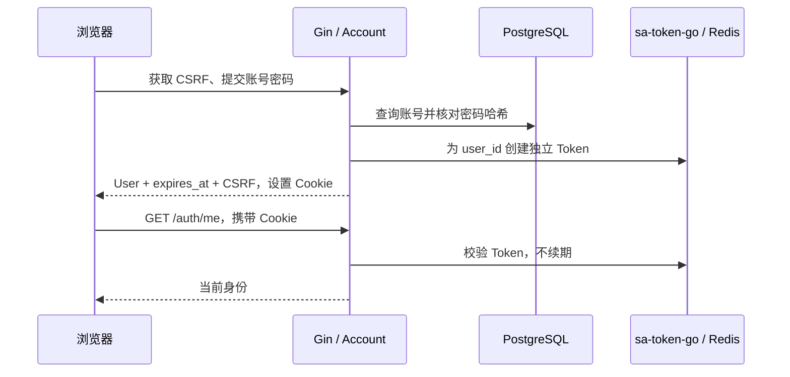

# M1：账号、会话与投稿骨架

状态：待评审，未实现。前置为 M0 中数据库、认证、开发入口验证通过。

## 1. 本阶段新增与沿用

新增注册/登录页、当前身份和退出交互、我的投稿空态/列表骨架；新增账号和投稿元数据的正式 API。沿用 M0 的基础服务、Gin/React 入口和已验证的 sa-token-go 适配。文件上传按钮的完整行为在 M2 接入，本阶段不能显示“上传成功”或“发布成功”。

## 2. 数据设计增量

| 表 | 本阶段字段/约束 | 写入入口 |
| --- | --- | --- |
| users | 完整建表；username 保留大小写且大小写敏感唯一，password_hash 非空，UUID 主键 | 注册 |
| submissions | id、author_id、title、description、state、processing_stage、version、media_generation、process_cycle、error_*、retryable、published_at、deleted_at、created_at、updated_at；发布禁用 | S01 创建上传意图 |
| idempotency_records | 完整建表，唯一“用户/操作/键”，过期索引 | S01 与业务写入同事务 |
| Redis | sa-token-go adapter 管理的身份和 Session；应用不依赖其内部 key 格式 | 登录、退出、过期 |

SQL 结构以共享草案为准。M1 的 submissions 尚无媒体外键和合规媒体参数；M3 的完整发布 CHECK 在相关列引入后建立。此阶段任何请求都不能直接写 published。

## 3. 接口与页面映射

| 页面/动作 | 接口 ID | 请求与结果 |
| --- | --- | --- |
| 注册页 | A01、A02 | 先取得 CSRF，提交 username/password；201 后引导登录 |
| 登录页 | A01、A03 | 错误账号/密码统一提示；成功保存 Cookie 并进入我的投稿 |
| 页面刷新 | A04 | 返回 User 与固定 expires_at；401 回到未登录展示 |
| 退出 | A05 | 撤销当前 Token、清 Cookie，其他浏览器保持登录 |
| 创建元数据 | S01 | 作为后续上传动作的第一步；Idempotency-Key 防止重复创建 |
| 我的投稿 | S02、S03 | 仅本人、游标分页；不暴露他人私有记录 |

字段、状态码和响应形状见 [接口契约](api-contract.md)，不得另造一套登录响应或分页格式。

## 4. 事务和错误设计

注册在入库前完成参数验证与哈希计算，数据库唯一约束处理并发重名；唯一冲突映射 USERNAME_TAKEN，不返回数据库原始错误。登录密码验证成功后才允许调用 sa-token-go Login；对不存在账号和错误密码使用相同公开错误。

登录态创建失败时返回 503，不能只因为密码正确就设置一个无效 Cookie。注册成功与自动登录分开，避免数据库和 Redis 跨服务写入伪装成一个原子注册操作。

S01 同事务插入投稿及幂等记录，初始 uploading，version/media_generation/process_cycle 均为 1。幂等键冲突必须比较请求哈希；接口超时后重试不会出现第二个投稿。

仅本人可以读取私有投稿。第一版没有独立创作者角色，所有已登录用户都可以创建投稿；资源归属必须通过 author_id 检查，不能只做 CheckLogin。

## 5. 会话和中间件落地

固定七天，无自动续期，多浏览器独立 Token；当前端退出只调用 LogoutByToken。登录 Cookie 与 CSRF Cookie 的创建、换发、删除由项目 HTTP 层处理，并检查真实响应头。时间测试使用短 TTL/可控时钟验证同一规则，不修改正式七天配置。

正式接入请求 ID、slog、panic 恢复、统一错误、body 大小限制、参数校验、身份和 CSRF。注册及登录限流按总架构初值实现；媒体独立超时策略在 M3 接入，不能提前给所有响应套整段缓冲。

## 6. 验收

| 编号 | 操作与通过条件 |
| --- | --- |
| M1-AC-01 | 合法注册成功且保留用户名大小写；`Alice` 与 `alice` 可分别注册；完全相同用户名的重复注册和并发重复注册只保留一个账号，其余返回 409 |
| M1-AC-02 | 数据库只保存密码哈希；登录按用户名大小写精确匹配；仅有 `Alice` 时使用 `alice` 登录失败；两者均存在且使用不同密码时，分别只能登录对应账号，不能跨账号匹配；错误账号/密码均不能建立登录态 |
| M1-AC-03 | Cookie 属性正确、JSON 不含身份 Token；缺失/错误 CSRF 的写入被拒绝 |
| M1-AC-04 | 刷新保持身份，访问不延长七天期限；到期返回明确未登录状态 |
| M1-AC-05 | A/B 两浏览器独立登录，A 退出不影响 B；重复退出可安全处理 |
| M1-AC-06 | API 重启后仍可使用未过期 Token；Redis 故障不会绕过鉴权 |
| M1-AC-07 | 同键同内容创建投稿返回同一 ID，同键不同内容 409；没有任何创建路径直接发布 |
| M1-AC-08 | 我的投稿分页和单项读取只返回本人内容，伪造作者字段被拒绝 |
| M1-AC-09 | 超大请求、参数错误、限流、panic 都产生规定的响应与可关联日志，不泄露密码/Cookie |

阶段证据至少包括浏览器注册/登录/退出演示、HTTP 与真实 PostgreSQL/Redis 的集成结果、表结构迁移记录。纯 mock 的认证通过不能代替库与 Redis 的集成验证。
