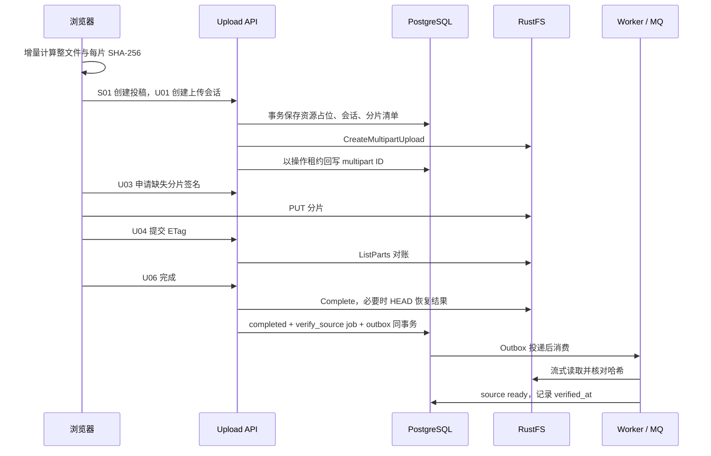

# M2：上传、续传与源文件完整性

状态：待评审，未实现。前置：M1 身份与投稿元数据；M0 的直传、S3 和 MQ 验证通过。目标是让一次上传可恢复、可校验、可解释，并把后续处理需求可靠交给后台。

## 1. 本阶段增量

新增正式投稿页的文件选择、标题/简介、校验进度、分片上传、暂停后恢复和错误展示。我的投稿开始显示上传进度与源文件校验状态。此阶段不承诺编码合法或可播放，也不能自动发布；M3 负责媒体探测与播放链路。

新增 media_objects、upload_sessions、upload_parts、jobs、job_attempts、outbox_events；submissions 增加 source_media_id / source_verified_at。所有字段与索引见共享 SQL，不能把分片状态仅保存在浏览器。

## 2. 请求时序

## 3. 上传协议的确定参数

| 项目 | 设计 |
| --- | --- |
| 单文件 | 1～1,000,000,000 字节 |
| 分片 | 8,388,608 字节；末片可以较小，最多 120 片 |
| 浏览器并发 | 最多三片，单片失败只重传该片 |
| 校验 | Web Worker 增量 SHA-256，整文件及每片各一份；后端独立复核 |
| 地址有效期 | 每次最多 15 分钟，可重新申请，不能延长已关闭会话 |
| 操作租约 | 初始化/完成 60 秒，外部调用上限 30 秒 |
| 空闲期限 | 有效活动后七天；普通轮询不续期 |
| 身份边界 | 上传会话由投稿 author_id 推导归属；不能仅凭会话 UUID操作 |

创建会话时，文件清单即不可变。浏览器只保存投稿 ID、上传 ID、文件哈希、分片信息及幂等键；不保存身份 Token 或整个文件。刷新后要求用户重新选择文件，匹配内容哈希和大小后才恢复，不以文件名代替身份。

## 4. API 与数据变化

U01～U06 的完整请求/响应在 [接口契约](api-contract.md)。关键副作用如下：

| 接口 | 数据库副作用 | 外部调用 |
| --- | --- | --- |
| U01 创建 | 创建 staging 源资源、creating 会话和全部分片描述；同事务记录请求幂等 | 按租约初始化 multipart，回写 uploading |
| U02 查询 | 可刷新已确认分片，不更新闲置期限 | 必要时 ListParts |
| U03 签名 | 检查状态、归属、片号，更新有效活动时间 | 仅为该 upload/key/part/长度生成签名 |
| U04 确认 | 将远端确实存在且大小匹配的分片记为 uploaded | ListParts，不信任浏览器的 ETag 声明 |
| U05 恢复 | 比对不可变文件信息并续期，返回服务端分片状态 | ListParts 对账 |
| U06 完成 | 回写 completed；创建唯一 verify_source 任务与 Outbox；投稿 processing/verifying | 只有后端可 Complete |

源对象 key 采用 `submissions/{submission_id}/source/{upload_id}/original`，文件名不进入 key。CreateMultipart 时写入 upload_id、预期大小等元数据，用于 Complete 结果未知时核对对象归属；这些元数据不代替真正哈希验证。

## 5. 初始化、完成与恢复

初始化先保存业务意图，再调用 S3。重复请求在数据库领取同一个操作租约，不并发创建两个有效会话。若 S3 成功而回写失败，维护流程按精确 key 查找孤立 multipart，选择/恢复有效编号并中止多余实例；不能按宽泛前缀中止别人的上传。

完成前核对分片编号连续、远端大小、清单和总大小。Complete 调用超时不能直接判失败或盲目开始新上传：保持 completing，以对象 HEAD 和会话元数据核对结果；对象存在且匹配后进入同一个幂等完成事务，否则在租约恢复后重试。此处对象尚为 staging，未经完整性检查不能成为可发布源文件。

源文件验证任务流式读取对象，逐 8 MiB 边界比较分片哈希并比较总哈希/大小。匹配后将 source 资源设 ready、记录 source_verified_at；不匹配则投稿 failed、retryable=false，提示重新投稿。存储临时故障走有限任务重试，不能误报文件损坏。

M2 结束时校验通过的投稿停在 processing/queued；M3 的升级接管会为其创建 probe 任务。普通用户不会看到“已发布”。

## 6. 任务与 Outbox 基础设施

M2 首次建立正式任务运行机制：verify_source 使用 processing 队列，上传过期清理使用 cleanup 队列。jobs / outbox_events 随同业务变化一次事务提交，后台发送循环在事务外发布；确认成功且没有不可路由结果后标 sent，结果不确定则重发。

消费者按 job_id / dispatch_seq 查询数据库，检查任务可执行、媒体代次有效并领取 lease_token。已完成消息可直接确认；有效租约仍存在的重复消息不另起执行。过期租约由维护循环恢复，因此 ack 一个重复消息不会把未完成工作的唯一凭据丢掉。

同一次有效领取使 attempt_count 加一，消息投递次数不计为处理次数。可重试任务最多四次尝试，延迟为 10、30、120 秒；按 available_at 持久化下一次派发，不使用无限立即 nack/requeue。非业务重试的 Outbox 网络失败独立计数。

投递进入死信后，维护循环校验 job_id/dispatch_seq。仍是当前派发且未完成的媒体任务以 DELIVERY_EXHAUSTED 标记可重试失败，页面不再永久显示等待；清理工作按退避继续派发。已有有效执行租约的情况由租约恢复机制负责，不能仅凭一条旧死信覆盖当前任务结果。

## 7. 过期和清理

维护循环每分钟检查过期上传及未创建会话的 uploading 投稿。先在事务中设 expired、递增 media_generation、清除会话操作租约并创建 cleanup 任务，再对 S3 执行 Abort/Delete。签名申请与过期处理必须串行检查同一会话，过期后不能生成新授权，迟到的初始化/完成回写不能使投稿恢复。

cleanup 的对象不存在视为成功，暂时故障持续退避重试，单次清理执行有时间上限。源文件完成后不再按上传闲置规则清理；正常源视频按产品规则保留到投稿删除。

## 8. 验收

| 编号 | 操作与通过条件 |
| --- | --- |
| M2-AC-01 | 单次点击创建一份投稿和会话；重复创建请求不产生重复记录 |
| M2-AC-02 | 多分片文件可上传，三片并发上限和进度显示正确，最后一片长度准确 |
| M2-AC-03 | 断网、关闭页面、过期签名后选择同一文件，只补传缺失部分 |
| M2-AC-04 | 同名同大小但内容不同的文件拒绝续传；改名但内容相同可以续传 |
| M2-AC-05 | 伪造分片确认、越界片号、越权会话、超过文件上限均被拒绝 |
| M2-AC-06 | 重复 Complete 或 Complete 成功后 API 崩溃，不会重复建投稿/校验任务 |
| M2-AC-07 | 存储中的实际字节被篡改时校验失败，不进入可发布链路；ETag 不被当成 SHA-256 |
| M2-AC-08 | MQ 不可用时完成需求留在 Outbox；恢复后校验执行，状态可见 |
| M2-AC-09 | 七天无活动过期且清理分片；页面轮询不能无限保活；已完成源视频不误删 |
| M2-AC-10 | 存储临时故障与内容不合规显示不同原因，失败记录不泄露对象凭据 |
| M2-AC-11 | 当前阶段的校验成功投稿仍不可公开播放；M3 接管所需标记可持久查询 |

每项故障验收应记录故障注入点、HTTP/数据库最终状态与对象清单，不仅录制一个成功上传动画。
