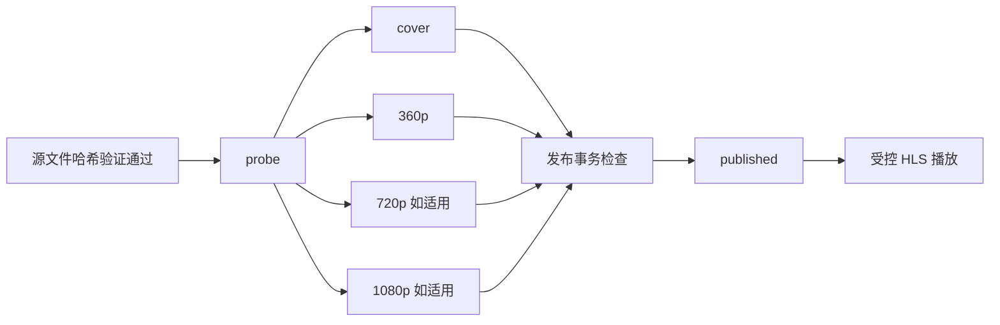

# M3：探测、转码、自动发布与播放

状态：待评审，未实现。前置为 M2 源文件完整性、任务及 Outbox 链路可运行。

## 1. 本阶段新增

新增媒体参数和 media_variants，正式接入 ffprobe / FFmpeg；新增封面、多档 HLS、自动发布、首页与详情页、播放器和作者重试入口。RabbitMQ 派发处理任务，PostgreSQL 决定发布，RustFS 只保存私有成果。

图中多个任务表示逻辑独立，当前处理消费者并发仍为一；已经成功的目标可以独立保留。

## 2. 数据、接口与页面增量

| 对象 | 增量 |
| --- | --- |
| submissions | 合规媒体参数、cover_media_id、完整发布约束；processing_stage 和错误反馈开始覆盖完整流水线 |
| media_variants | 每个符合源分辨率的目标档位一行，保存状态、有效 playlist 引用、尺寸、时长和带宽 |
| jobs / attempts / media_objects | 使用既定结构，新增 probe/cover/transcode 类型的实际处理器 |
| 公开接口 | P01 首页、P02 详情、P03 播放信息、P04 主清单、P05 媒体资源 |
| 作者接口 | P06 手动重试，S03 返回目标/已完成清晰度及失败情况 |
| 页面 | 首页分页、详情播放、作者处理状态和重试操作 |

## 3. 探测与目标生成

下载/读取已验证源视频到本次任务工作目录，ffprobe 解析 JSON。只接受实际 MP4 容器、H.264 视频、AAC 或无音轨、正时长且不超过 1,800,000 ms、展示方向为横屏且画面高度 360～1080。旋转元数据和像素宽高比须计入展示尺寸，不直接拿未经解释的 coded width/height 判断。

验证通过后才写入受约束的媒体参数。目标高度为集合 `{360,720,1080}` 中不高于源展示高度的项。目标宽度按展示宽高比求最近的正偶数，不把低清源视频放大到更高档位。probe 成功事务创建缺失的封面/清晰度任务及 Outbox，重复执行不得重复生成目标行。

封面在 `min(1秒, 时长/2)` 位置截取，保持比例输出 JPEG；它是发布条件之一。封面失败与转码失败一样必须反馈，不能用一个无效地址假装成功。

## 4. 转码输出契约

| 项目 | 设计初值 |
| --- | --- |
| 视频 | H.264，yuv420p，软件编码作为可复现基线，CRF 23，preset veryfast |
| 尺寸 | 指定目标高度和比例对应偶数宽度，输出方形像素；保持源播放速度 |
| 音频 | 源有音轨时 AAC 128 kbps；源无音轨时不伪造音频 |
| HLS | MPEG-TS 分片，VOD playlist，目标分片时长 6 秒 |
| 切片 | 闭合 GOP，在预定切片边界强制关键帧；主清单只声明实际生成的能力 |
| 并发 | 一个处理消费者，各档独立任务；单次 FFmpeg 初始线程上限 2 |
| 超时 | verify_source 5 分钟、probe 1 分钟、cover 2 分钟、单档 transcode 60 分钟；均可配置并记录实际耗时 |
| 消费确认 | RabbitMQ 对应队列 ack 超时初始 90 分钟，必须大于单任务上限及收尾余量；M0/M3 核实固定版本行为 |

这些编码参数是初版画质/耗时权衡，M5 根据实测记录调整，不把调整变成新增清晰度或更改源文件支持范围。FFmpeg 用参数数组启动，不拼接用户输入成 shell 命令。

每次尝试在隔离目录输出，并写入包含 job_id / lease_token 的唯一对象前缀。先核对清单、ENDLIST、全部非空分片及可读取性，再登记成果。单个档位的所有对象登记与该档 ready 变更在同一个数据库事务中；写入失败的半成品不作为有效版本。

## 5. 原子发布与重复执行

每个 cover/transcode 任务完成后进入短事务，按固定顺序锁投稿和当前任务，检查：投稿 processing、media_generation 匹配、lease_token 有效、当前尝试仍拥有结果提交权。有效成果被采纳后，检查源文件已验证、probe 参数合规、封面 ready，且目标集合与 ready 集合完全一致。

满足全部条件才设置 published、published_at、version++。目标集合不能是意外空集；不是“至少一个档位成功”就发布。数据库提交前对象写入可能成功，但没有有效引用的成果只能被清理，不能绕过发布条件。

消息重复到达时，已成功任务直接确认；正在有效执行的任务不重复启动；租约过期后只能由新的执行 Token 接管。旧进程的结果提交失败时清理它自己的尝试目录，不能删除新进程成果。

## 6. 失败与手动重试

编码/格式不支持、源哈希不匹配属于不可重试失败；短暂 I/O、进程退出、超时等按原因映射 retryable。媒体处理每个任务首次执行后最多三次自动重试。某档失败保留其他 ready 档位，投稿仍不公开。

作者 P06 重试只有 failed/retryable 时有效。同事务增加 process_cycle，为失败/缺失目标生成新的任务和 Outbox，清除本轮对外错误；不更换源文件，不复制投稿，不重做现有 ready 档位。旧轮次的失败任务保留用于解释历史，新轮次仍需通过发布条件。

## 7. 播放与可见性

P03 返回可播放主清单地址和档位信息。P04 根据当前 ready 档位生成主清单；P05 读取私有资源并将 variant playlist 中的相对分片引用改写为本应用的媒体 ID URL。清单和分片每次请求都核验父投稿 published。

播放器使用 hls.js，提供播放/暂停、进度、音量、全屏和手动清晰度选择。切换后保持当前时间附近继续播放；拖动或切换触发的中止请求不记为服务端故障。Range 请求按单范围处理，客户端断开取消上游读取。对播放器只暴露可用状态和错误，不暴露 worker、对象 key 或消息队列参数。

## 8. 验收

| 编号 | 操作与通过条件 |
| --- | --- |
| M3-AC-01 | 360/480/720/1080p 样本生成正确目标集合，比例正确且不升档放大 |
| M3-AC-02 | 不合法容器/编码/方向/时长被拒绝；无音轨样本可正常处理播放 |
| M3-AC-03 | 封面与全部分片可读且清单完整，各档切片关键帧/时间边界可切换；半成品不会被登记为 ready |
| M3-AC-04 | 任意目标档位或封面未就绪时不发布；全部成功后自动出现于首页 |
| M3-AC-05 | 首页只返回已发布内容并正确分页；详情及媒体对未发布内容拒绝访问 |
| M3-AC-06 | Chrome 中拖动、音量、全屏与切换清晰度可演示，媒体流不被 JSON 超时包装截断 |
| M3-AC-07 | 一个档位故障后自动重试有上限；成功档位保留；手动重试成功后只发布一次 |
| M3-AC-08 | 重复投递、转码中重启、旧执行迟到，都不会接受失效成果 |
| M3-AC-09 | M2 遗留的“源已校验、待处理”投稿能够被幂等接管，不需用户重新上传 |
| M3-AC-10 | 播放器断开、异常 Range、对象临时不可用产生可解释结果；没有匿名读取私有源文件的路径 |
