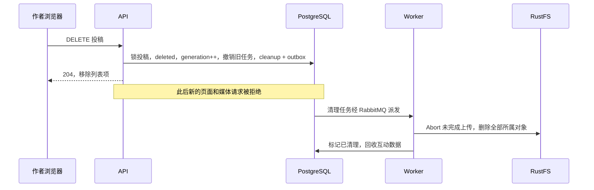

# M4：互动、资料编辑与删除

状态：待评审，未实现。前置为 M3 已发布投稿与受控播放；作者/游客身份规则沿用 M1。

## 1. 本阶段增量

新增 likes、comments、danmaku；接入资料修改、删除投稿和媒体清理。新增界面区域为详情页点赞/评论/弹幕、作者列表的编辑与删除操作，不增加关注、回复、私信、设备管理或管理员后台。

| 能力 | 接口 | 数据/事务 |
| --- | --- | --- |
| 编辑资料 | S04 | 校验 author_id 和 If-Match；更新 title/description/version |
| 删除投稿 | S05 | 原子写墓碑、失效媒体代次及任务，创建清理任务和 Outbox |
| 点赞/取消 | C01/C02 | likes 复合唯一键；同步计算结果 |
| 评论列表/发表 | C03/C04 | comments，纯文本、游标分页，创建使用幂等记录 |
| 删除评论 | C05 | 允许评论作者或投稿作者，软删除并清空 body |
| 弹幕读取/发送 | D01/D02 | danmaku，视频毫秒时间、快照窗口和幂等记录 |

## 2. 互动写入的共同事务

开始事务，读取并锁定父投稿的可见性，确认 published，再插入/删除互动关系；删除投稿采用冲突的锁确保提交顺序明确。如果互动先提交，删除随即使它不可见；如果删除先提交，互动返回 404，不能在已删除投稿下继续写入。

点赞 PUT 用唯一约束实现插入或已有，DELETE 删除关系，不维护 Redis 计数。前端串行处理当前按钮操作，避免快速点击使较旧响应覆盖较新意图。

评论与弹幕的重复网络请求复用 Idempotency-Key。纯文本渲染，不把内容解释为 HTML。评论删除保留作者和父投稿标识以判定重复删除权限，但正文清空；已删除内容不在列表中出现。投稿删除后的互动清理由后台完成，对外隐藏由父投稿状态立即保证。

## 3. 弹幕时间轴设计

- position_ms 使用发送瞬间的 video.currentTime 换算，不使用服务器现实时间。范围为 0 到视频时长之前。
- 首次播放信息提供 snapshot_at；后续弹幕请求沿用此快照时间。前端按 30 秒窗口加载，提前加载下一窗口，单次请求范围不超过 60 秒；超过一页继续按游标取齐。
- 使用 ID 合并跨页/跨窗口及本地新发弹幕。当前观众发送成功后立即显示，其他观众刷新后才取得新快照。
- 滚动进度根据媒体时间计算；暂停时停止移动。拖动进度清空当前渲染队列并重建对应窗口，不能把跳过的整段弹幕在一帧里全部补发。
- 第一版固定普通白色滚动文本，最多六条可用轨道，单条按八秒媒体时间滚动；拥挤时本次渲染可跳过无法安排的弹幕，但不删除存储数据。关闭弹幕后停止绘制，重新打开按当前时间继续。

## 4. 资料编辑与并发

作者打开编辑框时使用当前 version；S04 只接受 title/description。版本已变化返回 412，页面重新读取并提示用户核对，不静默覆盖另一窗口的修改。标题/简介变更不修改源文件、不改变媒体代次、不发转码消息。

已过期或已删除投稿不允许修改；上传中、处理中、失败或已发布投稿可编辑资料。对不存在和非本人资源都返回 404。

## 5. 删除时序

删除事务使未完成 upload 会话 aborted，清空操作租约；非终态处理任务 cancelled 并失效租约。正在运行的 FFmpeg 在下一次心跳发现失效后终止；即使它已写完对象，最终提交条件也不成立。

清理范围由服务端的投稿 ID 与命名空间生成，覆盖源视频、封面、全部清晰度和孤立尝试成果。客户端不传清理 prefix。先按登记清单删，再按精确投稿前缀查找未登记成果；删除不存在对象算成功。

每轮清理运行最长五分钟；未完成则持久化后续工作并重新投递。存储暂时失败使用持续重试、指数退避上限五分钟，不能因为媒体处理任务的三次重试上限而永久放弃删除。迟到的上传可能留下新对象，因此清理需在有界网络调用结束的等待期后复查；初始静默观察期 180 秒，至少两次扫描无对象/未完成 multipart 且无有效处理租约，才标记完成。周期性孤立文件扫描兜底。

已经传输或缓冲到浏览器的字节不能撤回；验收边界是删除事务提交后发起的新媒体请求拒绝，不要求抹除客户端缓存。媒体响应不使用可绕过此边界的公开缓存。

## 6. 验收

| 编号 | 操作与通过条件 |
| --- | --- |
| M4-AC-01 | 作者编辑资料后列表/详情更新，其他用户无法编辑；旧 version 返回 412 |
| M4-AC-02 | 同用户重复或并发点赞只有一条关系；取消可重复，计数不为负 |
| M4-AC-03 | 评论发表/分页/空态符合契约，重复键不产生第二条评论 |
| M4-AC-04 | 评论作者和投稿作者能删除，其他人不能；正文清空且列表不再返回 |
| M4-AC-05 | 弹幕按视频时间出现，分页/窗口不重复，快照控制其他观众的新弹幕可见性 |
| M4-AC-06 | 暂停、拖动、关闭再打开弹幕行为正确；位置越界和超长文本被拒绝 |
| M4-AC-07 | 删除上传中/处理中/已发布投稿后，新页面和媒体请求拒绝，重复删除安全 |
| M4-AC-08 | 删除与任务完成/互动写入并发时不会复活投稿或留下可见互动 |
| M4-AC-09 | 源视频、封面、档位和未登记的旧尝试对象最终被清理，正常投稿资源不被误删 |
| M4-AC-10 | 清理遇到存储故障后持续可恢复，恢复后完成，不需要用户再次点击删除 |

证据需包含两个用户与两个浏览器的权限案例、删除前后媒体请求结果、对象清单和最终任务状态。
